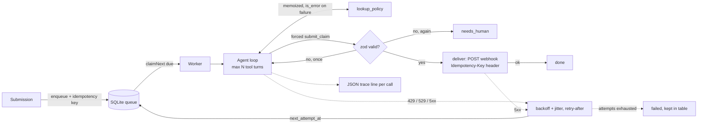

# claude-agent-reliability-kit

A small reference implementation of the patterns that make a **Claude tool-use agent reliable in production**, built around one realistic task: extracting structured data from insurance claim submissions and handing it to a downstream workflow (e.g. n8n).

Reference implementation by Simon Dziak (App369). It is a teaching/demo repo: it has not been deployed anywhere or used with real customer data, and the sample claims are invented.

TypeScript, Node 22.13+, official `@anthropic-ai/sdk`, `zod`, and Node's built-in `node:sqlite` (no native builds).

## The five failure modes and the fix for each

| Symptom | Fix here | Where |
|---|---|---|
| **Agent loops on a tool**, hammering a policy-lookup API | Hard cap on tool turns (default 5) then status `needs_human`; per-claim memoization so an identical lookup returns the cached result (with a "don't call again" note); tool failures returned as `tool_result` with `is_error: true`, each with the matching `tool_use_id` | `src/agent.ts` |
| **Malformed JSON breaks the downstream workflow** | Final answer comes from a forced `submit_claim` tool (`tool_choice`) whose JSON schema is generated from the zod schema; output is validated, one repair retry sends the exact validation errors back, then `needs_human`. Invalid rows are never delivered | `src/schema.ts`, `src/agent.ts` |
| **Submissions silently lost on 429/529** | Durable SQLite queue with an idempotency key (hash of the submission) and states `pending / processing / done / needs_human / failed`. The worker retries 429/5xx/529 and network errors with exponential backoff + jitter, honoring `retry-after`. Exhausted retries park the row as `failed` (still stored, replayable). SDK retries are turned off so the queue owns all retrying | `src/queue.ts`, `src/worker.ts`, `src/retry.ts` |
| **API cost creeping up** | Prompt caching (`cache_control`) on the system prompt and tool definitions, trimmed tool results, bounded turns, memoized lookups, and no model re-call when only webhook delivery failed (the validated result is stored first) | `src/tools.ts`, `src/agent.ts`, `src/worker.ts` |
| **Minimal logging** | One JSON line per model call: claim id, turn, phase, stop reason, input/output/cache-read/cache-write tokens, latency, queue retry count (and the error on failures) | `src/trace.ts` |

## Architecture



Flow: the agent runs a bounded tool phase (`tool_choice: auto`), then a forced `submit_claim` call, then validation. API errors bubble up to the worker, which reschedules the row instead of retrying in-process, so a crash mid-backoff loses nothing (rows left in `processing` return to `pending` on startup).

## Run it

```bash
npm install
npm test            # 15 tests, no network or API key needed
npm run typecheck   # tsc --noEmit
npm run demo        # 4 sample claims through a scripted fake model
```

The fake-model demo deliberately misbehaves: one claim gets a 429 (retried after `retry-after`), one first submits a malformed amount (repaired), one policy is lapsed and one is unknown (both submitted with `coverage_confirmed: false`). Re-enqueueing a sample is a no-op.

Live mode:

```bash
cp .env.example .env   # add ANTHROPIC_API_KEY; optionally CLAUDE_MODEL, WEBHOOK_URL
node --env-file=.env --import tsx src/demo.ts --live
# or: export ANTHROPIC_API_KEY=... && npm run demo -- --live
```

Default model is `claude-sonnet-5-5`, override with `CLAUDE_MODEL`. The key is read only from `ANTHROPIC_API_KEY`. If `WEBHOOK_URL` is set, validated rows are POSTed there with an `Idempotency-Key` header.

Tests use a scripted fake Anthropic client plus an injectable clock/sleep, so backoff tests run instantly. They cover: loop cap, cached lookup, matching `tool_use_id`s and `is_error`, forced `tool_choice` and cache markers, repair success, repair failure, 429-then-success with `retry-after`, 529 exhaustion (row kept as `failed`), idempotent re-enqueue, webhook delivery with retry, crash recovery, and backoff math.

## Layout

```
src/agent.ts      tool loop, memoization, forced submit, validate + repair
src/schema.ts     zod schema -> JSON schema for submit_claim
src/tools.ts      tool definitions and system prompt (cache_control)
src/policy.ts     fake in-memory policy lookup
src/queue.ts      SQLite queue, idempotency key, states
src/worker.ts     drain loop, retries, delivery
src/retry.ts      error classification, backoff + jitter, retry-after
src/deliver.ts    webhook POST with Idempotency-Key
src/trace.ts      JSON-line tracing
src/fakeClient.ts scripted and demo fake clients
src/demo.ts       npm run demo
samples/          invented claim texts
test/             node:test suites
```

## Limitations

- Single-process worker. Several workers would need row locking or a lease column (SQLite is fine for a demo; use Postgres or a managed queue for real scale).
- Memoization is per claim, in memory only. No cross-claim cache and no rate limiter on the policy API.
- The policy tool is fake and the claim schema is deliberately small. The demo's fake model is rule-based, so the demo shows the plumbing, not extraction quality.
- Only the non-streaming Messages API is used, and there are no token-cost calculations. Prompt caching only pays off once the cached prefix passes the model's minimum cacheable length; this repo's short prompt may be below it, so check `cache_read_tokens` in the traces on real traffic.
- `failed` and `needs_human` rows need an operator or a replay script; none is included.
- Live mode has not been exercised against the real API in this repo's tests.

## License

MIT, see `LICENSE`.
